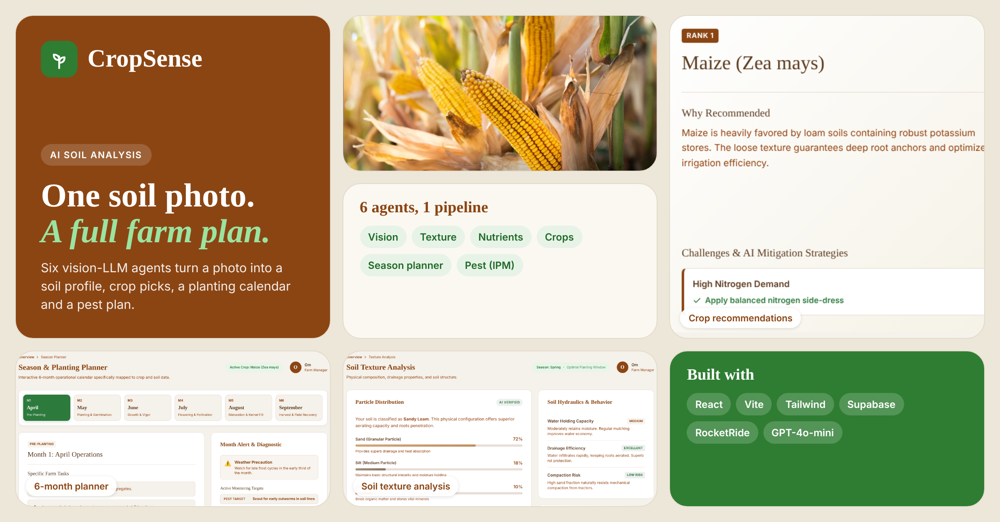

# CropSense: AI Soil Analysis and Crop Planning



CropSense turns a single photo of soil into a farm plan. Upload a soil photo, add your location, farm size and climate zone, and a six-agent AI pipeline returns a soil profile, the five best crops for your land, a six-month planting calendar, and a pest and disease management plan.

Built for small and mid-size farmers who can't easily get a lab soil test before deciding what to plant.

> Screenshots show the app's built-in sample data.

## What it does

| Step | Agent | Output |
|------|-------|--------|
| 1 | **Vision Analysis** | Soil color, structure, moisture, visible organic matter, compaction signs, surface cracks, residue |
| 2 | **Texture Classification** | USDA texture class, sand/silt/clay percentages, water holding capacity, drainage, workability |
| 3 | **Nutrient Assessment** | Estimated N, P, K and organic matter status, pH estimate, suspected micronutrient deficiencies |
| 4 | **Crop Recommender** | Top 5 crops ranked by suitability, with soil/climate fit, yield, water needs, pest risks, mitigation steps and rotation advice |
| 5 | **Season Planner** | Month-by-month tasks, irrigation schedule, fertilizer timing and amounts, critical actions, weather alerts |
| 6 | **Pest Management** | Integrated pest management plan: high-risk pests and diseases, scouting methods, organic and chemical controls, IPM calendar |

Every agent returns strict JSON that the frontend renders into a report.

## Architecture

```
Soil photo
    |
    v
 Parse (RocketRide)
    |
    +--> Vision Analysis ------+
    +--> Texture Classification |
    +--> Nutrient Assessment    +--> Response --> React report UI
    +--> Crop Recommender       |
    +--> Season Planner         |
    +--> Pest Management -------+
```

The pipeline is defined in [`Imageanalysis.pipe`](./Imageanalysis.pipe) and runs on [RocketRide](https://github.com/rocketride-org). Each agent is a narrowly scoped vision-LLM prompt (GPT-4o-mini) with a fixed JSON schema, which keeps outputs structured and easy to validate.

## Tech stack

- **Frontend:** React 18, Vite, Tailwind CSS, Framer Motion, React Router
- **AI orchestration:** RocketRide pipeline with six vision-LLM agents
- **Backend services:** Supabase (see [`supabase-migration.sql`](./supabase-migration.sql)); Google Generative AI SDK
- **Language:** JavaScript

## Getting started

**Prerequisites:** Node.js 18+, a Supabase project, an OpenAI API key, and a RocketRide setup.

```bash
git clone https://github.com/OmKadam16/CropSense.git
cd CropSense
npm install
```

1. Create a Supabase project and run `supabase-migration.sql` in its SQL editor.
2. Copy `.env.example` to `.env.local` and fill in your own keys. Never commit keys.
3. Open `Imageanalysis.pipe` in RocketRide and add your OpenAI key through RocketRide's configuration, not in the file.
4. Start the app:

```bash
npm run dev
```

Build for production with `npm run build` and `npm run preview`.

## Limitations

- **Estimates, not lab results.** Nutrient levels, pH and texture percentages are inferred from a photo. Photos can't measure chemistry. Use them to guide decisions, then confirm with a soil test before spending on inputs.
- **Lighting and camera affect results.** Soil color changes a lot with light and moisture.
- **Region coverage depends on the model's knowledge.** Crop, climate and pest advice should be checked against local agricultural extension guidance.
- **Pesticide suggestions are informational only.** Follow local regulations and label directions.

## Roadmap

- Validate photo-based estimates against lab soil test data
- Add multi-photo input per field
- Save field history and compare seasons
- Localized crop and pest databases

## Author

Built by [Om Kadam](https://github.com/OmKadam16).
